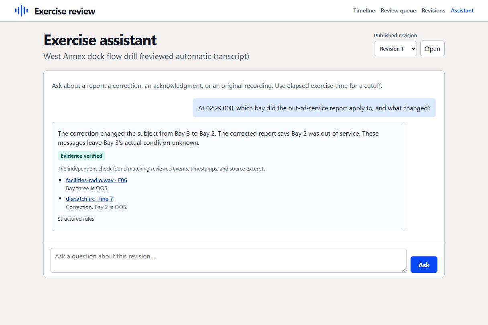

# Roxi

[](https://github.com/RejectKid/roxi/actions/workflows/ci.yml) [](https://github.com/RejectKid/roxi/releases)

Roxi turns recorded radio and chat from completed exercises into a searchable record. Review reports, corrections, and acknowledgments on one timeline, publish a revision, and ask questions whose answers link to the original clip or message.



- **Review the timeline.** Play audio at the relevant offset and see where a source lacks an exercise-time anchor.
- **Publish a revision.** Keep reviewed events, transcript edits, and original evidence together so earlier answers are reproducible.
- **Ask or integrate.** Use the local assistant, or query the same published records over HTTP and read-only MCP.

## Quickstart

The bundled West Annex demo uses Python 3.13, Docker Desktop running Linux containers, and Windows PowerShell with **Microsoft David Desktop** and **Microsoft Zira Desktop**. The audio generator runs locally and produces the WAVs needed by the demo.

```powershell
git clone https://github.com/RejectKid/roxi.git
cd roxi
powershell.exe -NoProfile -File tools/Build-DrillAudio.ps1
docker compose up -d --wait db
py -3.13 -m venv .venv
.venv/Scripts/python.exe -m pip install -r requirements.txt
.venv/Scripts/python.exe -m review_app migrate
.venv/Scripts/python.exe -m review_app import fixtures/drill-01/input/exercise.json
$env:ROXI_ACCESS_MODE = 'demo'
.venv/Scripts/python.exe -m uvicorn review_app.app:app --host 127.0.0.1 --port 8000
```

Open [the West Annex timeline](http://127.0.0.1:8000/exercises/drill-01). The first import reports **3 sources, 62 records, and 1 intentionally malformed chat line**. Follow the [demo walkthrough](docs/DEMO.md) to publish a revision, ask your first question, and open its citations. If you already have the generated WAVs and a working environment, start at the import or server step.

The default app and database bind to loopback. PostgreSQL persists in the Compose volume and evidence files are archived under `.local/archive`. Use this setup with synthetic or authorized local records. [Troubleshooting and restart commands](docs/TROUBLESHOOTING.md)

## Documentation

| What you want to do | Guide |
| --- | --- |
| Review, publish, and ask about the West Annex drill | [Demo walkthrough](docs/DEMO.md) |
| Replay warehouse chat and see classifications as messages arrive | [Live sandbox walkthrough](docs/LIVE-DEMO.md) |
| Load CSV, fleet, and weather sources and inspect freshness | [Source catalog and replay](docs/SOURCE-CATALOG.md) |
| Review one exercise at two time cutoffs and open map evidence | [Map and history replay](docs/HISTORY-REPLAY.md) |
| Ask about history, subscribe to changes, or install the Roxi skill | [History assistant, HTTP, SDK, MCP, and voice](docs/HISTORY-INTERFACES.md) |
| Set up workspace accounts, grant source access, and operate a pilot | [Pilot access and operations](docs/PILOT-OPERATIONS.md) |
| Query published events and open source evidence | [HTTP and MCP examples](docs/API.md) |
| Run local speech-to-text or repeat the answer-key evaluation | [Transcription and pilot evaluation](docs/PILOT-EVALUATION.md) |
| Evaluate transcription and evidence playback on recorded radio | [Apollo 11 replay benchmark](docs/APOLLO-11-EVALUATION.md) |
| Fix setup, playback, or MCP problems | [Troubleshooting](docs/TROUBLESHOOTING.md) |
| Run tests or prepare a release | [Contributing](CONTRIBUTING.md) · [Changelog](CHANGELOG.md) |
| Understand the architecture and next milestones | [Technical specification](docs/PROJECT-SPEC.md) · [Implementation plan](docs/IMPLEMENTATION-PLAN.md) · [Live data roadmap](docs/LIVE-ROADMAP.md) |

The app can route more freely worded questions through local Ollama. The scripted demo uses the built-in question rules and succeeds without a model download. [Optional Ollama setup](docs/DEMO.md#optional-local-language-model)

## Fixture and licensing

The public fixture includes the authored WebVTT, IRC-style chat, glossary, manifest, and answer key. The WAVs are generated on your Windows machine. Roxi is publicly viewable on GitHub. A separate open-source license has yet to be selected. [Fixture provenance](fixtures/drill-01/README.md)
