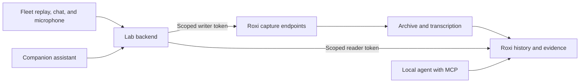

# Dockside integration lab

The lab is a standalone example of an app built on Roxi. Two fictional warehouse delivery crews, Blue and Red, send chat and radio updates while their vans move through a simulated yard. Open the assistant beside the capture controls or in its own tab. Both views get their data from a running Roxi instance.

## Run it

Run these commands from the repository root on Windows with Python 3.13 and the project dependencies installed. [Quickstart](../README.md#quickstart)

```powershell
docker compose up -d --wait db
.venv/Scripts/python.exe -m examples.integration_lab
```

Open [Dockside integration lab](http://127.0.0.1:8181/). The launch command starts two loopback HTTP services, provisions a new fictional exercise, and starts a local Faster Whisper worker scoped to that exercise. The first run may download `small.en`. Use `--offline` with cached weights, `--no-speech` for the track and chat walkthrough, or `--port 8182` to choose another lab port. On Linux, use `.venv/bin/python`.

Use the terminal's Ctrl+C to stop the lab. Roxi keeps the exercise records and originals in its configured local database and archive. Each launch uses a fresh exercise ID and temporary scoped API credentials. Use invented updates in the lab.

## Walk through the demo

| Do this | What it proves |
| --- | --- |
| Click **Step** twice or run **Play replay**. | Two vehicle feeds appear as paths built from normalized observations. At step 2, the crews make different reports about the same receiving gate. |
| Click **Open assistant tab**, then **Where are the vans?** | A companion client reads the latest visible fleet records. Click either fleet citation to open the exact JSON observation. |
| Ask **Which reports disagree?** | Roxi returns both reports and citations to the original Blue and Red channel messages. The reports remain in conflict. |
| Stop at step 3 and ask **What changed?** | Roxi compares with the pin captured before that replay step. Look for the loading bay correction, its acknowledgment, and changes to vehicle positions. |
| Choose a crew, type `Blue Van is in service.`, and click **Send chat**. | The message becomes a typed record through Roxi, with source, subject, reported status, and original message. Open **View JSON** to see what an agent receives. |
| Click **Record mic**, allow microphone access, and say “Blue Van is in service.” Click **Stop & send**. | The browser submits a bounded PCM WAV. Roxi saves it before transcription. Wait for **Radio transcript ready in Roxi**. Ask **What was recorded?**, open the crew's radio citation, and play the cited interval. |

The chat and radio reports remain proposals. Confidence in a generated transcript comes from checking the original audio. For a reviewed version, export the communications at a fixed pin and publish through Roxi's review workflow. [Export and publish a snapshot](INTEGRATING-ROXI.md#publish-a-fixed-communications-snapshot)

## See the integration boundary



The sample's [host backend](../examples/integration_lab/app.py) talks to Roxi over HTTP. Only the [launcher](../examples/integration_lab/__main__.py) provisions the demo workspace and starts the services. Another application can use its own token provisioning and connect to an existing Roxi process.

| Sample action | Roxi interface | Contract detail |
| --- | --- | --- |
| Send chat | `POST /v1/exercises/{id}/channels/{crew}-chat/captures` | `roxi.channel-chat/v1` includes a message ID, input version, sender, and observed time. |
| Send a completed call | `POST /v1/exercises/{id}/channels/{crew}-radio/captures` | The [browser client](../examples/integration_lab/web/lab.js) encodes mono 16 kHz PCM WAV. The backend wraps it in `roxi.completed-radio/v1` and polls the scoped capture status. |
| Advance the track feed | `POST /exercises/{id}/sources/fleet/captures` | The fictional replay sends `roxi.civilian-fleet/v1` vehicle positions, statuses, and timestamps. |
| Ask for van positions | `GET /v1/history/query` | A domain-specific answer in the host groups the latest observations by reviewed vehicle identity. It uses returned positions and citations. |
| Ask about changes and conflicts | `POST /v1/history/answer` | The built-in history assistant returns structured facts and gaps. The lab supplies the current pin and the baseline from the latest replay step. |
| Open evidence | `GET /v1/history/evidence` then its returned path | The host preserves the citation's pin and forwards byte-range requests for audio. The browser receives the audio without a Roxi token. |

The launch process keeps reader and ingestion credentials out of browser code. The browser calls the same-origin lab backend. The backend scopes every call to the lab exercise and obtains the original path from Roxi's evidence resolver. The companion's **Where are the vans?** answer shows how a developer can add a domain question using typed data. Conflicts, changes, and recorded observations use Roxi's own question handler. For local agents, the same history records and citations are available through `query_history` and `get_history_evidence`. [App and agent integration guide](INTEGRATING-ROXI.md)

## Verify it automatically

Run `python tools/check_integration_lab.py` with the three database URLs set to a fresh disposable database. The test starts real HTTP services, submits the fixture and a bounded test WAV, and verifies the fleet positions, conflicting chat, changed records, and byte-exact evidence downloads. CI injects a reference transcript for its audio sample. The interactive lab uses local speech recognition. [Contributor test setup](../CONTRIBUTING.md#test-a-change)
