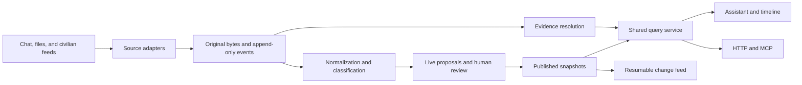

# Roxi live data roadmap

Roxi will expand from reviewing one recorded exercise to answering questions about multiple, continuously updated sources. The initial deployment target is a consented civilian logistics or facilities pilot. Replay and after-action review use fictional drills or authorized non-combat records. The first slice is a warehouse chat room whose messages become searchable, cited proposals while the conversation is happening.

## Milestones

| # | Build | Completion check |
| --- | --- | --- |
| **9. Live chat and replay** | Ingest messages from one sandbox logistics chat room through a webhook, with an NDJSON replay adapter for development. Store originals, normalize message and edit events, and stream new proposals into the timeline and review queue. Classify reports, acknowledgments, corrections, and ordinary chatter. | A replay with duplicates, edits, and late delivery produces one stored original per source version. Stop and resume the worker without losing acknowledged input. On a named pilot workstation, sustain 10 messages per second for 15 minutes with p95 under 3 seconds from receipt to visible proposal. |
| **10. More source types** | Add a versioned adapter contract and source catalog. Ingest a CSV asset and site register, one civilian transit or synthetic fleet feed, and one environmental or public weather feed. Display last successful fetch, schema version, source latency, and coverage gaps. | The same ingestion and evidence contract handles chat, files, and external observations. A bad payload becomes inspectable, an unavailable feed appears stale, and replay after a parser update creates auditable derived versions. |
| **11. Time, identity, and maps** | Add an entity registry for facilities and civilian assets. Link source-specific IDs through reviewed aliases. Show recent reports, sensor observations, and versioned geographic layers together on a map and timeline. Expose `as_of` and `known_at` filters. | Replaying an earlier view gives the same result. A late observation appears after its receipt time and never silently rewrites what users could see earlier. Ambiguous identifiers remain unresolved and conflicting observations stay visible. |
| **12. An assistant and developer interfaces** | Add source-backed answers for “what changed?”, “what is overdue?”, and “which updates disagree?”. Add a typed query model, OpenAPI examples and SDK, plus the same read operations over MCP. Include a change feed with resume tokens for application integrations. Prototype push-to-talk questions and spoken briefings after the text path passes evaluation. Package an [exercise review skill](#installable-exercise-review-skill) once the read interface is stable. | UI, HTTP, and MCP return the same claims and evidence for a pinned view. A reconnecting client resumes without gaps. Every supported claim opens exact authorized evidence. Missing context, invalid citations, and planted misleading content are exercised in the evaluation. The packaged skill passes the synthetic demo in at least two tested clients. |
| **13. Pilot access and operations** | Add authenticated workspaces, separate ingestion, review, and reading permissions, source-level access, retention and deletion tooling, and operational dashboards. Document deployment, backups, restore, and connector health. | Access revocation takes effect for source links, snapshots, API calls, and MCP. A restore exercise recovers the data and checkpoints. A disconnected or backlogged source is obvious to operators. Finish these checks before collecting real participant messages. |
| **14. Civilian pilot and evaluation** | Run a small, authorized receiving-dock or facilities pilot. Compare the live assistant and structured timeline with the user's existing process using the same categories and equivalent questions. | Measure time to a supported answer, missed corrections, false links, review load, and citation accuracy. Publish performance and failure cases, and use the results to choose the next connectors and interface changes. |
| **15. Live multi-source replay** | Run one civilian logistics exercise with two independent chat channels, two audio channels, a static asset and site register, and a changing simulated fleet feed. Start audio ingestion at completed transmissions, using the existing local speech recognizer, archive, and review queue. Give every source a stable key and preserve event time, receipt time, and the original evidence location. | A deterministic replay delivers all sources on one clock and shows each completed radio call as a transcript or an explicit coverage gap. A chat correction links to a radio report and plays the cited original. Duplicate inputs, late messages, a source outage, and a worker restart produce no lost or duplicated accepted input. Measure time from end of call to visible proposal by source. |
| **16. Structured records and reconciliation** | Extend the typed model to describe asset and site observations, status reports, acknowledgments, corrections, and conflicts across the live paths. Extract structured proposals from radio and chat with versioned rules, and score any optional model-assisted extraction on held-out material. Reuse reviewed aliases to resolve chat names, radio names, and fleet IDs. Keep each assertion, its effective and receipt times, its review state, and its source evidence addressable. Expose ambiguous matches and stale or missing coverage for review. | A question about a vehicle's check-in and location combines the same entity across radio, chat, and fleet records. The answer key includes an ambiguous alias, a late fleet update, a correction, and an unresolved conflict. Evaluate false and missed links and exact evidence playback on a held-out exercise. |
| **17. Shared operator and agent queries** | Build a common read view over the same structured records. Extend the operator timeline and assistant, versioned HTTP and SDK, read-only MCP tools, and resumable change feed. Let users pin event-time and known-time cutoffs. Add a guided entry point to the right exercise and make evidence review and publication state visible in context. | For the same cutoffs and authorized sources, the UI, HTTP, and MCP return the same records, conflicts, gaps, and original evidence. An external agent reproduces the structured answer and opens its sources. A reconnecting subscriber resumes after its checkpoint, and source revocation takes effect for both the answer and its evidence links. |
| **18. Timed pilot and release** | Run a small timed, consented civilian facilities or logistics pilot on the integrated workflow. Make the synthetic demo easy to start from a fresh checkout. Prepare a public release candidate with the current code, changelog, CI coverage, fixture provenance, and docs for the operator and developer workflows. | Record time to a supported answer, time spent reviewing before publication, citation accuracy, missed corrections, and false links. Capture failures and verify the demo and release candidate on a clean machine. Evaluate skill distribution separately once the setup and licensing are ready. |

The initial speed and load numbers are engineering targets. Measure them on a named machine and revise them once the source mix and pilot workload are known.

## Current implementation and evidence

- **Milestones 1–8** delivered the recorded West Annex exercise, versioned review and publication, local speech recognition, evidence-backed answers, and the public v0.1.0 release.
- **Milestones 9–13** added live sandbox chat, a versioned source catalog with asset, site, fleet, and weather data, time-aware history and reviewed identities, HTTP and read-only MCP queries, an SDK, a resumable change feed, and pilot access and recovery checks.
- **Milestone 14** produced archived radio benchmarks and a guided fictional reviewer session. The assistant answered four of four questions in the Willow round, and the participant reported opening all seven expected evidence links. The participant estimated under one second for answers to appear. End-to-end question and review times still need a measured session on authorized material. [Pilot evaluation](PILOT-EVALUATION.md)
- **Milestones 15–17** added the civilian multi-channel replay, typed live context, and the external integration contract. The automated fixture checks a radio-to-chat correction through publication, a shared identity across radio, chat, and fleet, ambiguous aliases, conflicts, late data, restart, revocation, and exact archived evidence. The local speech check uses one generated West Annex call. A held-out multi-source link evaluation and per-channel latency sample remain part of the pilot. [Integration guide](INTEGRATING-ROXI.md) · [Replay and evaluation](LIVE-CONTEXT-PILOT.md)
- **Milestone 18** prepares the v0.2.0 candidate and evaluation runbook. The timed pilot remains open pending a consenting reviewer and authorized material. [Pilot runbook](LIVE-CONTEXT-PILOT.md#run-a-timed-pilot)
- The current live chat worker supports one registered room per exercise. Audio is transcribed from files, and the history view reads chat and catalog observations. Milestone 15 connects those paths through a scored replay. Milestones 16 and 17 make the resulting structured records usable across sources and clients.

## Architecture and data contract

- **Source event.** Record a workspace, source, source event key and revision, payload kind and schema, event time when known, receipt time, and original evidence reference. Store connector provenance and raw digests. Scope deduplication to the workspace and source. Model edits and deletions as new source versions so replay explains what changed while access and retention still apply. Start from CloudEvents field conventions and map them into Roxi's internal schema. [CloudEvents specification](https://github.com/cloudevents/spec/blob/v1.0.2/cloudevents/spec.md)
- **Derived record.** Store a type, normalized fields, classification method and version, evidence locators, review state, and links such as `corrects` and `acknowledges`. Keep uncertain classifications in the queue. Keep original text and observed values distinguishable from reviewer decisions. W3C PROV provides a vocabulary for describing where a record came from and what produced it. [W3C PROV overview](https://www.w3.org/TR/prov-overview/)
- **Current and historical views.** Mark new proposals visibly and require explicit review for published snapshots. Let users pin an observed-time cutoff and a receipt-time cutoff. Preserve distinct values when sources disagree. Each view shows which sources are included, whether they are fresh, and which readings or timestamps are missing.
- **Storage and queues.** Keep PostgreSQL for normalized data, publication, and a durable processing queue. Continue archiving original bytes by digest. Add per-connector checkpoints, bounded retries, backlog limits, and a quarantine for malformed events. Introduce external object storage or a broker when measured storage, throughput, or consumer isolation warrants it. NiFi provides useful examples of lineage, material replay, and backpressure. [Apache NiFi user guide](https://nifi.apache.org/nifi-docs/user-guide.html)
- **Evidence locators.** Support message ID and version, source row or JSON pointer, audio interval, and geospatial feature ID with its source layer version. Resolve each locator through the same access policy as the original. Include `supported`, `conflicting`, or `insufficient_evidence` states at the claim level. Test whether claims remain supportable as sources change or become unavailable. [NIST Generative AI Profile](https://nvlpubs.nist.gov/nistpubs/AI/NIST.AI.600-1.pdf)

## Source priorities

| Priority | Source | Pilot use |
| --- | --- | --- |
| First | Authorized chat and NDJSON replay | Categorize dock reports, corrections, acknowledgments, and ordinary discussion as messages arrive. |
| First | CSV and JSON uploads | Load a facility and equipment register plus maintenance events. Keep source row numbers and import diagnostics. |
| Next | Public transit or synthetic civilian fleet | Use scheduled updates and public vehicle positions to validate late records, identity mapping, or missing updates. [GTFS Realtime reference](https://gtfs.org/documentation/realtime/reference/) |
| Next | Environmental observations and public weather | Attach building or weather observations to site records while preserving their units and coverage. [OGC SensorThings Sensing](https://www.ogc.org/standards/sensorthings/) · [National Weather Service API](https://www.weather.gov/documentation/services-web-api) |
| Next | Civilian facility maps and public elevation | Add facility features and elevation when a defined accessibility or facilities question requires them. Record layer versions, coordinate reference systems, and applicable attribution. [OGC API Features](https://www.ogc.org/standards/ogcapi-features/) · [USGS 3D Elevation Program](https://www.usgs.gov/3d-elevation-program) |
| Milestone 15 | Fictional radio replay | Ingest completed transmissions for two channels. Retain audio offsets, transcript status, and coverage. |
| Pilot | Consented recordings and transcripts | Use the same evidence-backed ingestion path with an authorized source. Measure recognition, finalization latency, and review load. |

## How people and applications use it

- **Assistant.** Support questions such as “What changed at the receiving dock since the last shift?” and “Which facilities updates disagree?” Answer with a time window, the sources checked, claim-by-claim citations, and explicit coverage gaps. Add saved questions and reviewable shift summaries after the single-question flow works.
- **HTTP and SDK.** Use OpenAPI for stable typed queries, pagination, versioned results, and client generation. Offer bounded operations for timeline search, entity history, snapshot comparison, and evidence resolution. Keep aggregation and temporal checks in the service so callers receive reproducible results. [OpenAPI specification](https://spec.openapis.org/oas/latest.html)
- **MCP.** Reuse the same query service for assistant and agent reads. Expose feature and event schemas as resources and use structured results for evidence and coverage. Keep stdio for local use and evaluate authenticated remote MCP as part of the pilot permission work. [Model Context Protocol architecture](https://modelcontextprotocol.io/docs/learn/architecture) · [MCP security practices](https://modelcontextprotocol.io/specification/latest/basic/security_best_practices)
- **Change feed.** Provide resumable server-sent events for browser updates and a versioned subscription contract for system consumers. Publish content identifiers, revision stamps, and event types. Managed integrations fetch details under their own authorization. Document schemas and delivery guarantees with AsyncAPI when there is a second consumer. [Server-sent events](https://developer.mozilla.org/en-US/docs/Web/API/Server-sent_events/Using_server-sent_events) · [AsyncAPI specification](https://www.asyncapi.com/docs/reference/specification/v3.1.0)
- **Operator view.** Show connector health, last received event, queued or failed work, and per-class review outcomes. Record throughput, p95 delay, retry rates, and source availability. Keep message text out of routine telemetry. [OpenTelemetry signals](https://opentelemetry.io/docs/concepts/signals/)

## Installable exercise review skill

- **Package and test.** Ship a portable `SKILL.md` with connection instructions for Roxi's read-only MCP server and a synthetic quickstart. Teach the agent when to use Roxi, how to pin a revision, how to cite the exact source, and how to report conflicting or insufficient evidence. Test installation and the same cited answer in at least two compatible clients. [Agent Skills specification](https://agentskills.io/specification)
- **Evaluate distribution.** Once the package passes those checks, evaluate Agensi as an optional listing channel for an exercise review skill. Decide the skill's distribution license and whether to offer it free or paid. Review the current seller terms, compatibility, and update process before listing. [Agensi seller guide](https://www.agensi.io/sell)

## First implementation tickets for Milestone 15

1. Extend a synthetic West Annex-style fixture with two chat sources, two radio sources, a small fleet feed, and an answer key kept outside ingestion. Include a chat correction to a radio report, a duplicate delivery, a delayed observation, and an unresolvable clock or identity case.
2. Deliver one chat source and one audio source from the same replay clock. Store the original message and WAV, transcribe a completed call, and surface the transcript and its evidence in review.
3. Add the second chat and audio channels and the fleet feed. Keep message and clip IDs scoped to their sources, and verify the review path from radio report through chat correction to publication.
4. Run deterministic replay, restart, permission, and exact evidence checks in an isolated workspace. Record per-source ingest and proposal latency, match results against the fixture key, and use the failures to refine the event types for Milestone 16.

## Initial live chat implementation tickets

1. Add a synthetic chat replay fixture with deterministic delivery times, edits, duplicates, and disconnects. Include an answer key for which messages should be classified and why.
2. Define the source event and locator schemas. Implement idempotent capture and checkpointing for the sandbox webhook.
3. Reuse the existing glossary and correction rules to produce proposals. Add one live timeline stream and retain manual review and publication.
4. Run restart, backlog, duplicate, stale-source, and evidence-access checks. Record latency and classification results before choosing the second connector.
