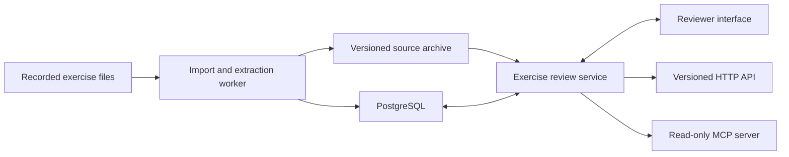

# Exercise Communications Review Platform

This platform turns recorded voice and chat from a completed exercise into a searchable, evidence-linked record. A reviewer can trace a proposed conclusion to the original audio or message. Developers can build a chatbot, evidence verifier, or reporting client against the same published exercise revision through HTTP or the Model Context Protocol (MCP).

## Scope and users

The first deployment processes completed, fictional logistics drills from local files. The same product scope covers retrospective safety reviews and non-combat logistics exercises using authorized recordings. The first test asks whether structured links help reviewers reconstruct reports, acknowledgments, and corrections faster and more accurately than synchronized logs alone.

| User | Workflow |
| --- | --- |
| Exercise organizer | Creates an exercise, imports recordings and chat, and supplies timing and glossary information. |
| Reviewer | Plays source evidence, reviews proposed links, corrects transcripts, and publishes a revision. |
| Developer | Retrieves a published revision, queries typed events, and opens the sources behind a result through HTTP or MCP. |

## Architecture and storage



Use a Python application with FastAPI for the HTTP boundary, a separate worker process from the same codebase, PostgreSQL, and a versioned object archive. A local file adapter can implement the archive for the pilot using immutable file keys, with an S3-compatible adapter available when deployment calls for it. The service is the common place for exercise access, revision lookup, query semantics, and evidence resolution. Publish the HTTP contract through OpenAPI. [FastAPI features](https://fastapi.tiangolo.com/features/) · [OpenAPI specification](https://spec.openapis.org/oas/v3.1.1.html) · [S3 object versioning](https://docs.aws.amazon.com/AmazonS3/latest/userguide/Versioning.html)

Keep original bytes and checksums in the archive. Use typed PostgreSQL columns for identifiers, review state, timing, and commonly filtered values. Use `jsonb` for validated type-specific payloads and connector metadata. Start with B-tree indexes for exercise and revision membership, foreign-key lookups, and timeline order. Add PostgreSQL full-text search for message and transcript text, plus exact matching on known aliases. Measure lookup and search on a larger fixture before adding another search service. [PostgreSQL JSON types](https://www.postgresql.org/docs/current/datatype-json.html) · [PostgreSQL full-text search](https://www.postgresql.org/docs/current/textsearch.html)

### Data model

| Record | Purpose and essential fields |
| --- | --- |
| `exercise` | Stable ID, name, optional UTC start, owner, and processing state. |
| `source_file` | Exercise ID, source key, source kind, original filename, archive key and version, SHA-256, media type, size, and import time. |
| `source_record_version` | Stable record ID plus immutable version ID, exercise ID, source-file version, raw text or transcript, channel and speaker label where known, capture timing, and parser or transcription provenance. |
| `subject` and `glossary_entry` | Exercise-local IDs and versioned labels or aliases. Start with drill assets such as `bay-2` and exercise terms such as `OOS`. Keep unresolved aliases visible in the source text. |
| `event_version` | Stable event ID plus immutable version ID, type, subject if identified, optional time stated in the message, typed payload, review state, and extraction or reviewer provenance. |
| `relationship_version` | Versioned `acknowledges` or `corrects` edge between event IDs, review state, and evidence. Require endpoints in the same exercise and reject cycles in accepted correction relationships. |
| `evidence` | Stable ID pointing to an exact source-record version, a file version, and a locator. Source search, events, and relationships cite these IDs. A locator is a half-open audio interval in milliseconds or an inclusive, one-based line range. |
| `exercise_revision` | Exercise ID, revision ID, publication time and publisher, and a manifest of the exact record, event, relationship, subject, glossary, and coverage versions visible to clients. |
| `import_job` and `audit_entry` | Job state, per-source errors, deduplication data, and trace identifiers. Audit entries record who imported, reviewed, published, or accessed evidence. |

Use UTC `timestamptz` for wall-clock and audit timestamps, and integer milliseconds for audio offsets and positions within the exercise. Use foreign keys and constraints for exercise ownership and valid ranges. Evidence references stay stable across publication. A transcript edit creates a new source-record version and new evidence IDs for findings that cite the edit.

### Event types and meaning

| Type | Required content | Interpretation |
| --- | --- | --- |
| `status_report` | `reported_status` of `in_service`, `out_of_service`, or `unknown`. A subject can remain unresolved. | A source reported a status. A reviewer accepting the extraction confirms what the source said. |
| `acknowledgment` | The acknowledgment text and a reviewed `acknowledges` link when the referent is established. | The source acknowledged a message. The linked report retains its own status and evidence. |
| `correction` | A replacement subject, replacement reported status, or both. Include a `corrects` link when the earlier report is identified. | An accepted correction with an accepted link supersedes the targeted report in the derived view from the correction's capture time. Fields that the correction leaves unchanged carry forward from the linked report. The original remains visible. |

Event and link review states are `proposed`, `accepted`, and `rejected`. An ambiguous acknowledgment can retain its own event with candidate links in the review queue. When two accepted reports conflict and neither explicitly corrects the other, return both and mark the conflict for review. Any published event or relationship available through the agent API must have at least one evidence reference.

## Import, timestamps, and publication

1. **Import a completed exercise.** Accept PCM WAV audio, a UTF-8 IRC-style chat export, and an exercise manifest that names each source and declares the available timing anchors. Accept a timestamped WebVTT transcript as a repeatable fixture input. A speech-to-text worker can generate the equivalent segment records for audio-only uploads. Malformed lines go into an import report with their source line numbers. Valid lines remain available for review.
2. **Preserve timing and coverage.** Store three values separately when available. The capture position is where a message or utterance appears on the exercise timeline. The stated event time represents a time mentioned by the source. Import time is when the service received the file. Retain source timestamps and alignment methods, and represent uncertain capture time as a range or `unknown`. A missing clock anchor leaves the audio playable by file offset. Surface missing or unaligned sources prominently in the review and query results.
3. **Propose and review.** Apply exercise aliases and suggest reports, acknowledgments, and corrections. Present the original text, proposed link, and supporting excerpt together. A reviewer can edit a transcript, accept or reject a proposal, or leave a link unresolved. Save edits with a draft version check so two reviewers cannot silently overwrite each other.
4. **Publish a revision.** Validate references and publish revision membership atomically in a short database transaction. Readers see either the previous revision or the complete new one. Each published revision pins the underlying versions, including coverage and glossary. The organizer can publish another revision after fixing an import or review decision. Authorization and retention apply when a client retrieves any revision.

Use `(exercise_id, source_key, content_sha256, import_profile_hash)` to recognize import retries. The profile covers parser settings and timing anchors. Stage and verify the source before committing an archive reference. Run transcription outside the database transaction and give each processing attempt an idempotency key. A failed attempt exposes its stage and a retry action. A successful retry reuses the completed source and avoids duplicate visible records. Track per-source progress so a failed input can be retried independently.

### Pilot input formats

Use a UTF-8 manifest with an exercise ID and name, an optional `started_at_utc`, a glossary filename, and a `sources` array. Each source supplies a unique `source_key`, `kind` of `audio` or `chat`, and an exercise-relative `file` path. Audio sources can supply a `transcript_file` with WebVTT cue offsets and an `exercise_offset_ms` mapping audio offset zero to the exercise timeline. Leave the anchor null when start time is unknown. Chat sources declare `time_basis` of `exercise_elapsed` for the pilot. Parse `[HH:MM:SS] <handle> message` as elapsed time and preserve the exact original line. Use the source key as the channel in this format.

```json
{
  "exercise_id": "drill-01",
  "name": "Facilities logistics drill",
  "glossary_file": "glossary.json",
  "sources": [
    {"source_key": "facilities", "kind": "audio", "file": "facilities-radio.wav", "transcript_file": "facilities-radio.vtt", "exercise_offset_ms": 0},
    {"source_key": "secondary-radio", "kind": "audio", "file": "unaligned-radio.wav", "transcript_file": "unaligned-radio.vtt", "exercise_offset_ms": null},
    {"source_key": "dispatch", "kind": "chat", "file": "dispatch.irc", "time_basis": "exercise_elapsed"}
  ]
}
```

The glossary has exercise subject IDs with labels and aliases, plus term entries with literal and expanded forms. Validate manifest paths against the upload root and store files under service-owned keys. Additional chat formats can add their own parser profiles with explicit clock and time zone handling.

## Interfaces for developers

Use `/v1` for HTTP and map MCP tools to the same application operations. Define JSON schemas for request and result types. Resolve the latest published revision once using the `exercise_id`, then pass both `exercise_id` and `revision_id` to each data query in the agent run. [MCP tools specification](https://modelcontextprotocol.io/specification/2026-07-28/server/tools)

| HTTP operation | MCP tool | Input and result |
| --- | --- | --- |
| `GET /v1/exercises/{exercise_id}/revisions/latest` | `get_exercise_revision` | Exercise ID. Returns the current published revision ID, publication time, and source coverage summary. |
| `GET /v1/exercises/{exercise_id}/revisions/{revision_id}/records` | `search_records` | Optional text, channel, capture window, cursor, and limit. Returns source matches, timestamps, and evidence references. Omit text for a source timeline. |
| `GET /v1/exercises/{exercise_id}/revisions/{revision_id}/events` | `list_events` | Optional subject ID, event types, capture window, `as_of_ms`, review state, cursor, and limit. Returns matching events and eligible links, with evidence IDs and coverage. Defaults to accepted events. |
| `GET /v1/exercises/{exercise_id}/revisions/{revision_id}/evidence/{evidence_id}` | `get_evidence` | Evidence ID. Returns excerpt, source name, capture timing, exact locator, and relative paths for original source access and radio playback. |

Every successful query result includes the exercise and revision IDs. Revision numbers are positive integers within each exercise. Use a default page size of 25 and cap it at 100. Sort by capture position then stable ID, with unknown times last. Pagination cursors bind to the revision and filter set. Time windows use an inclusive start and exclusive end. For an `as_of_ms` query, include an event or link only when its supporting evidence needed for that finding was captured at or before the cutoff. A bounded timing estimate qualifies when its upper bound is at or before the cutoff. Report excluded uncertain times and known coverage gaps. An as-of result describes what the imported record contained by that time, with review decisions pinned to the selected revision. Include incoming and outgoing eligible links for matching events so a correction is visible even when it changed the subject used in the filter. Include the linked event ID, type, and subject in the relationship result.

The reviewer interface uses authenticated application operations to create exercises, upload sources, inspect jobs, edit transcripts, review events and links, and publish revisions. These write operations are available to authorized human users through the review app. A valid query with zero matches returns an empty collection and coverage metadata. Use error results with a stable code, message, request ID, and retryability flag.

| Error code | HTTP status | Condition |
| --- | --- | --- |
| `invalid_argument` | `400` | Invalid filter, time window, cursor, or input format. |
| `unauthenticated` | `401` | Missing or invalid identity for a protected endpoint. |
| `not_found` | `404` | Exercise, revision, or evidence is missing or hidden from the caller. |
| `draft_conflict` | `409` | Reviewer submitted an edit against an older draft. Refresh and reconcile before retrying. |
| `source_unavailable` | `410` | Source was purged or expired and the caller may view its metadata. |
| `temporarily_unavailable` | `503` | Database or archive is temporarily inaccessible. Retry with backoff. |

Serve versioned event definitions and glossary entries as discoverable MCP resources or resource templates. An example resource URI is `exercise-review://exercises/{exercise_id}/revisions/{revision_id}/glossary`. Provide a local MCP connection for the pilot. A shared network deployment uses authenticated HTTPS and the applicable MCP authorization flow. [MCP resources specification](https://modelcontextprotocol.io/specification/2026-07-28/server/resources) · [MCP authorization specification](https://modelcontextprotocol.io/specification/2026-07-28/basic/authorization)

### Example result

A radio recording contains “Bay three is OOS” at 02:04. At 02:29 the chat log says “Correction, Bay 2 is OOS.” After a reviewer confirms the link, the API can return this corrected subject report as a correction event.

```json
{
  "exercise_id": "drill-01",
  "revision_id": 2,
  "items": [
    {
      "event_id": 6,
      "event_type": "correction",
      "subject_id": "bay-2",
      "capture_offset_ms": 149000,
      "timing_quality": "exact",
      "review_state": "accepted",
      "payload": {"replacement_subject_id": "bay-2", "replacement_reported_status": "out_of_service"},
      "relationships": [
        {"type": "corrects", "direction": "outgoing", "event_id": 5, "event_type": "status_report", "subject_id": "bay-3", "review_state": "accepted", "evidence_ids": ["s1-r6-tf80b3d5c3c2eadd559c6bfd69ccd35934de4667b2b8a2b57298ddcb1639d30fe", "s3-r7"]}
      ],
      "evidence_ids": ["s3-r7"],
      "conflicting_event_ids": []
    }
  ],
  "coverage": {"aligned_sources": 2, "unaligned_sources": 1, "known_gaps": ["dispatch: 1 malformed chat line skipped", "secondary-radio: exercise clock anchor missing"], "unknown_time_excluded": 0},
  "next_cursor": null
}
```

An answer about the correction cites both the original radio and the chat. An answer about the bay's actual condition should state that this evidence establishes a reported condition. A question about whether it reopened later returns the latest supported report and the status of confirmation in the imported record.

## Reviewer and agent experience

- **Timeline.** Show radio and chat in chronological order, with channel filters, text search, and source coverage. Select an entry to play the matching audio or open the original chat lines. Provide an unstructured timeline view for comparison during testing.
- **Review queue.** Show proposed events and links beside the original records. Provide edit, accept, reject, and leave unresolved actions. Display the active exercise and published revision whenever reviewers open a finding.
- **Chatbot.** Answer questions within one exercise and one revision. Search source text for quotations and use structured events for filtering and relationships. Require resolvable evidence for factual claims. Surface contradictions, unaligned sources, and insufficient evidence in the answer.
- **Evidence verifier.** Take a draft claim and its revision and evidence IDs. Retrieve the cited records independently and return `supported`, `contradicted`, or `insufficient_evidence` with source references. Preserve the original draft for human review.
- **Follow-on clients.** Use the same contract for debrief drafts, maintenance handoffs, and reports on missed acknowledgments or source-quality problems in completed drills.

## Access, retention, and traceability

Assign access by exercise for the pilot. Reviewers can edit drafts, authorized publishers can publish, and agent clients read published revisions. Keep the database migration role distinct from application credentials. Apply access checks to both structured queries and file playback. Use exercise-scoped identities, bounds on tool response sizes, and audit entries containing principal, operation, revision, and returned evidence IDs. Keep source text out of routine application logs.

Treat imported text and audio transcripts as data in agent prompts. Tool authorization, scope, and parameters are validated by the service. Evidence previews escape imported text before rendering. A published revision preserves its references for the configured retention period. A retention purge or revoked permission makes the affected evidence unavailable through every client, including clients holding older revision IDs.

## Pilot acceptance criteria

| Area | Required demonstration |
| --- | --- |
| Import | A finished drill with WAV and chat appears in the timeline. A retried upload creates no duplicate records. A malformed line and an unaligned source are visible in the review. |
| Evidence | Every citation for the scored questions opens the expected file version and clip or line. |
| Revisions | One corrected transcript produces a new revision. The old revision still returns the original text and evidence under the same valid access. |
| Agent interoperability | The chatbot and verifier inspect the same revision through HTTP and MCP and agree on event and evidence IDs. |
| Answer behavior | The scripted questions exercise a correct answer, a cross-channel correction, an ambiguous message, a time cutoff, and insufficient evidence. Each supported answer is traceable. |
| Access | Requests outside an agent's exercise scope fail consistently for records, events, and direct evidence access. |
| Value | Compare the plain synchronized timeline with the structured view. Record time to a correct answer, missed links, and wrong links before expanding the pilot. |
